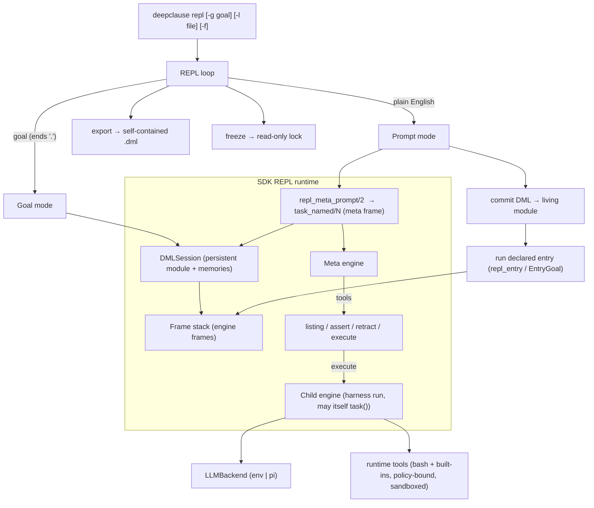
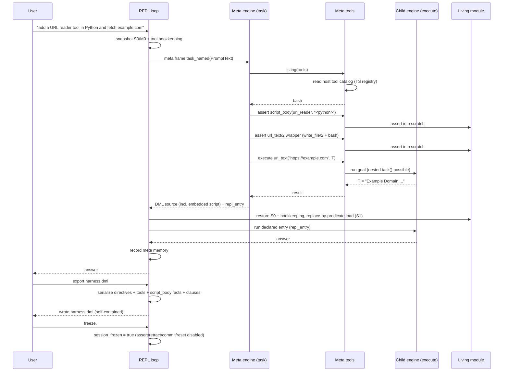

# The DML REPL — an RLM-style self-improving harness for DeepClause

## Status

Design proposal, second revision. Nothing in this document is implemented yet.
It is written against `deepclause-sdk` 0.0.89 and `deepclause-pi` 0.5.0.

This revision changes the primary surface from "pi extension feature" to **a
first-class CLI tool in the SDK**, and adds the central new mechanism: an
ordinary natural-language prompt is compiled, by the model itself, into a
`task/N` call whose result is DML source that the REPL loads and runs. The
living module is built up prompt by prompt and can be persisted with `export`.

> **Implementation:** sequenced in
> [`docs/DML_REPL_IMPLEMENTATION_PLAN.md`](./DML_REPL_IMPLEMENTATION_PLAN.md)
> (milestones M0–M7, file lists, acceptance tests). Keep both documents in sync.

## TL;DR

Ship `deepclause repl [-g goal] [-l file] [-f]`:

* **`deepclause repl`** — an interactive session that starts blank and lets the
  user grow a *living DML module* (facts, rules, `tool/2` definitions) either by
  writing DML goals directly or by typing plain English.
* **`deepclause repl -g "goal"`** — run one goal and exit, like `swipl -g`.
* **`deepclause repl -l harness.dml`** — load an exported harness before
  starting (or before `-g` runs).

The special mechanism:

```
plain English  ─►  repl_meta_prompt/2  ─►  task_named/N (meta frame)
                                        │  tools: listing, assert, retract, execute
                                        ▼
                                    DML source  ─►  load into the living module  ─►  run

export <file>  ◄── serialize self-contained harness (embedded scripts as facts)
freeze         ◄── make assert/retract/commit impossible (read-only)
```

* An ordinary prompt is translated into a `task_named/N` call run in a meta
  frame.
* The task is scoped to exactly five capabilities: `listing`, `assert`,
  `retract`, `execute` (any Prolog/DML goal), and `ask_user` (ask the human).
* The task returns **DML source**. The REPL commits that source to the living
  module and runs it.
* `execute` may run goals containing `task` predicates. That is the recursive
  model invocation that makes this an RLM-style harness; the design specifies
  its context, isolation, and budgets.
* `freeze` makes the living module **read-only** — it disables `assert` and
  `retract` (and any other mutation). `-f` starts the REPL already frozen.
* `export <file>` writes the whole living module to a self-contained `.dml`
  file, reloadable with `-l`.

The previous revision's SDK session/query/engine work (persistent module,
non-cutting solution enumeration, `solution` events) is still required and is
retained below; the pi extension becomes an optional embedding instead of the
primary UI.

---

## 1. Vision: an RLM-style self-improving harness

A "recursive language model" harness is a loop in which a model writes code in
an environment and that code can invoke the model again. The environment is
persistent, so the code the model writes accumulates into a program. DeepClause
is unusually well suited to this:

* DML is already a declarative program that sequences `task/N` model calls, with
  backtracking, CLP, tool calls, and threaded memory.
* The runtime already supports **recursive `task` calls**: a `task` may run a
  tool whose body calls `task` again (isolated engine).
* The runtime already supports **LLM-authored code**: DML files are just text,
  and pi's whole premise is that the model edits them.

The REPL closes the loop:

* **Meta level** — the *code-writing task*: the model reads the current harness
  and writes DML.
* **Object level** — the *harness run*: the DML executes, potentially calling
  `task` again, which is the recursive model invocation.

The living module is the artifact that compounds. Each prompt can:
1. define new facts and rules,
2. define new `tool/2` capabilities that later tasks can call,
3. define new named predicates and entry points selected by backtracking, and
4. test all of the above with `execute`.

The harness must be **self-contained**. If a generated tool needs Python, JS, or
shell code, that code is stored inside the harness as a DML fact (a string) and
materialized at run time — never left as an untracked side file. `export` then
turns the accumulated program into a portable `.dml` harness that survives the
process and can be versioned, diffed, and eventually hosted by `deepclause-pi`
as well.

`freeze` is a safety lock, not a serializer: once frozen, the harness is
read-only (no `assert`, no `retract`, no commits), so a compiled harness can be
run against a live model without risk of it rewriting itself.

The design keeps the two levels strictly separated so that model reasoning
about *writing* code never contaminates the *runtime* memory the harness uses,
while still allowing deliberate recursion.

---

## 2. User experience

### 2.1 Starting

```text
$ deepclause repl
DML REPL  (blank harness)
model: openai/gpt-4o   workspace: /home/me/project
type 'goal: <dml>.' for a DML goal, or plain English to build the harness.
type 'help.' for help, 'export <file>.' to save, 'freeze.' to lock, 'halt.' to exit.

dml> 
```

```text
$ deepclause repl -l harness.dml            # load an exported harness, stay interactive
$ deepclause repl -l harness.dml -g "explain_factorial"   # load, run one goal, exit
$ deepclause repl -g "member(X, [1,2,3])"   # pure query, like swipl -g
$ deepclause repl -l harness.dml -g "summarize('write a haiku')"
```

### 2.2 Goal mode (SWI-like)

```text
dml> goal: fact(0, 1).
fact(0, 1).

dml> goal: fact(0, 1).
true.

dml> goal: member(X, [a, b, c]).
X = a ;
X = b ;
X = c.

dml> goal: [lib/util.dml].
loaded lib/util.dml

dml> listing.
% fact/2
fact(0, 1).
fact(N, F) :-
    N > 0, N1 is N-1, fact(N1, F1), F is N*F1.
```

### 2.3 Prompt mode (build the harness)

```text
dml> add a rule that computes factorial, and a tool that formats integers
     with thousands separators.

(meta-task … listing harness … assert fact/2 … execute fact(5,F) … done)

committed 4 clauses (fact/2, format_int/2) (definitions only)

dml> use factorial to compute 10!

(meta-task … listing … define compute_factorial/0, repl_entry/1 … execute compute_factorial … done)

committed 2 clauses (compute_factorial/0, repl_entry/1)
running entry compute_factorial …
3628800
```

### 2.4 Recursive execution

```text
dml> add a rule best_summary/2 that asks the model twice and keeps the shorter text

(meta-task … asserts best_summary/2 … executes best_summary("...", R) …)
  ↳ object-level task #1 …
  ↳ object-level task #2 …
committed 3 clauses (best_summary/2, helper/1, …)
```

### 2.5 Self-contained tools, freeze, and export

```text
dml> add a tool that reads a URL and strips the HTML, using Python.

(meta-task … listing tools … assert script_body/2 with the Python source …
             assert url_text/2 wrapper … execute url_text("https://…", T) …)
committed 3 clauses (script_body/2, url_text/2, …)

dml> export harness.dml.
exported 20 clauses, 3 tools, 1 embedded script, 1 directive → harness.dml

dml> freeze.
harness frozen: assert/retract/load disabled. Use 'unfreeze.' to re-enable.

dml> goal: assertz(extra(1)).
ERROR: harness is frozen; assert/retract/load are disabled
```

The exported `harness.dml` carries the Python source as a fact, so it reloads and
runs anywhere with no missing side files:

```text
$ deepclause repl -l harness.dml -g url_text("https://example.com", T)
```

### 2.6 Starting frozen

```text
$ deepclause repl -l harness.dml -f
DML REPL  (harness.dml: 20 clauses, 3 tools)  [FROZEN]
dml> goal: explain_factorial.
…runs the harness entry, but cannot mutate the harness…
```

`-f` (or `--freeze`) starts with the read-only lock active. This is the safe way
to run an exported harness in production/CI: the model may still be called by
`task`, but no generated or accidental mutation can change the harness.

### 2.7 Asking the human (both levels)

The meta task can ask a clarifying question before it writes the harness:

```text
dml> add a price tracker

(meta-task …)
❓ Which ticker symbol should the tracker use?
> AAPL
(meta-task … listing tools … assert price/1, repl_entry/report_price/1 …)
committed 3 clauses (price/1, report_price/1, repl_entry/1)
running entry report_price …
AAPL is at 187.42
```

And the living harness can ask while it runs, through the ordinary `input/2`
predicate (or `exec(ask_user(prompt: ...))` inside a `tool/2`):

```prolog
report_price :-
    price(Symbol, P),
    input("Do you want the 30-day average too? (yes/no)", Answer),
    ...
```

Both channels render the same prompt and are cancellable. In non-interactive
runs (`-g`, piped stdin, CI) they do not block: the meta `ask_user` returns
`cancelled` and `input/2` fails, unless `--answer`/`--assume` is configured
(§13.6).

---

## 3. What we borrow from SWI-Prolog, and what we add

We studied the real top level in
`/home/andreas/emscripten/swipl-devel/boot/toplevel.pl` (2234 lines).

Reproduced from SWI:

| SWI behaviour | SWI implementation | DML REPL |
|---|---|---|
| `?- ` prompt, term read | `'$query_loop'/1`, `read_expanded_query/3` | `dml> ` prompt; `goal:` prefix + `read_term/3` |
| bindings + alternatives | `write_bindings/4`, `get_respons/2` | `solution` events + `;`/`.`/`a` pager |
| `false.` on failure | `'$execute_query'/3` | zero solutions ⇒ `false.` |
| syntax error re-read | `read_query_line/2` | re-prompt, multi-line continuation |
| `[file].` consult | `consult/1` | already works through `mi_call` |
| `listing.` / `help.` | `listing/0,1` | in-language helpers, captured output |
| `halt.`, `trace.` | toplevel | `mi_call(halt/0)`, `session_trace_enabled` |
| `-g goal` | command line | `deepclause repl -g goal` |

Added beyond SWI:

* **Prompt mode** — plain English compiled to DML by the model.
* **The five meta tools** — `listing`, `assert`, `retract`, `execute`,
  `ask_user`.
* **A living module with transactional edits** — the harness cannot be
  half-mutated by a failed prompt.
* **Two-level memory** — meta (code-writing) and harness (runtime) memory.
* **Self-contained harnesses** — embedded Python/JS/shell code lives in the DML
  as facts, so `export` captures everything.
* **`freeze`** — a read-only lock that disables `assert`/`retract`/load; `-f`
  starts frozen.
* **`export` / `-l`** — write and reload the harness.
* **`ask_user` at both levels** — the meta task can ask the human a clarifying
  question, and the living harness can ask through `input/2` /
  `exec(ask_user(...))`; both surface as the same input prompt.
* **`set-backend pi`** — use pi's configured model and credentials directly.
* **One built-in host tool: `bash`** — registered by default with the SDK's
  existing sandbox configuration. File reading/writing is done with DML/Prolog
  predicates (`open/3`, `close/1`, `read_string/3`, `write/2`, `write_file/2`,
  `read_file/2`, `append_file/2`), which are language, not host tools. The meta
  prompt carries the `bash` catalog (and any user/MCP tools explicitly enabled).
* **Budgets and recursion control** for RLM-style `execute`.

---

## 4. Runtime anatomy (what we build on)

### 4.1 The Prolog meta-interpreter

`deepclause-sdk/src/prolog-src/deepclause_mi.pl` is the whole language:

* `parse_dml/5` → `parse_dml_string/2` reads a file with `read_term/3
  [module(SessionId), variable_names(Bindings)]`, runs
  `preprocess_loaded_term/3` (`transform_task_calls/3` +
  `expand_interpolations/3` + `expand_term/2`), then asserts each term into the
  dynamic module `SessionId` via `process_clause/2`.
* `create_engine/6` builds `state{memory, params, context_stack, depth,
  gas_remaining}` and an SWI *engine* running `deepclause_mi:mi(Goal, State,
  SessionId)`. `determine_agent_goal/3` hard-codes `agent_main`.
* `step_engine/4` maps `engine_next/2` results to statuses via
  `process_engine_result/4`. `task/N` yields `request_agent_loop` and the host
  posts a result back.
* `mi_call/3` is a state-threaded meta-interpreter: disjunction restores state
  on backtracking, user predicates re-solve via `clause/2`, memory is
  backtrackable.
* `mi/3` cuts after the first solution and catches `'$answer_commit'` from
  `answer/1`.
* `destroy_engine/1` destroys the engine and retracts the whole session module.
* `with_tools/2` / `without_tools/2` set a `tool_scope` in state, which the
  runner uses to filter the DML tools offered to a `task`'s agent loop.

**Critical detail.** `task(Desc, Var1, …)` and `prompt(Desc, …)` do **not** exist
at runtime; `transform_task_calls/3` rewrites them to `task_named/3` /
`prompt_named/3` during file loading, and `is_mi_special_predicate/1` blocks the
generic fallback. Any goal read from the REPL must be run through the same
preprocessing or it silently fails. This applies to internally constructed task
   goals too (see §9.2).

### 4.2 The TypeScript runner

`deepclause-sdk/src/runner.ts` (`DMLRunner`):

* `run/2` generates a fresh `sessionId`, mounts the workspace, loads code,
  creates the `agent_main` engine, and drives the `while(true)` step loop.
* `handleAgentLoop`, `handleExec`, `handleSampleToken`, `handleLlm`,
  `handleJudgment` are the async request handlers and already use the injectable
  `LLMBackend`, tool policy, cancellation, and usage.
* `agent.ts` (`runAgentLoop`) streams assistant text (`text-delta` → `onStream`)
  and emits tool-call/usage events, but consumes `reasoning-delta` only for
  debug counters. `runner.ts` re-emits text as `stream` and tool activity as
  `tool_call`/`task_activity`; the reasoning channel is added in §15.2.
* `buildAgentTools/3` builds the tool set for a `task`'s LLM: **only DML
  `tool/2` predicates**, never registered TypeScript tools directly. TS tools
  are reached through `exec/2` inside DML tool bodies (`handleExec` /
  `executeToolIsolated`).
* `cleanup()` calls `destroy_engine`, so nothing survives a run.

### 4.3 The SDK CLI

`src/cli/index.ts` registers commands on `commander`, with a default `startTui`
for no arguments. `src/system/runtime/dml-executor.ts` is the CLI's execution
helper; it calls `createDeepClause` and `sdk.runDML`. `src/cli/config.ts`
resolves the `gateway` / `run` / `compile` model slots from
`.deepclause/config.json` and the bundled model database.

The REPL will be a new subcommand plus a small bin entry, reusing this
configuration and executor plumbing.

---

## 5. Why `runDML` cannot be the REPL

1. **Sessions are destroyed.** `cleanup()` → `destroy_engine/1` retracts the
   module. The REPL needs a persistent module.
2. **The entry point is fixed.** `create_engine/6` → `determine_agent_goal/3`
   only runs `agent_main`. The REPL must run arbitrary goal terms.
3. **Only one solution, no bindings.** `mi/3` cuts; `engine_yield` has no
   binding channel.
4. **The engine slot is a singleton.** `session_engine/2` holds one engine per
   session. Prompt mode needs *nested* engines (meta engine + `execute` engine +
   object-level `task` engines). This forces an engine-frame design (§8).
5. **Task preprocessing is load-time only** (see §4.1).

---

## 6. Architecture



Invariant: **prompt mode is a code-generation turn followed by a normal harness
run.** The meta engine never writes the committed harness directly; it edits a
scratch state that is discarded and replaced by the returned DML source.

---

## 7. The session model

### 7.1 The living module

The REPL owns one dynamic Prolog module, the **living module** (`SessionId`).
It starts empty. Across the session it accumulates:

* facts and rules (the harness logic),
* `tool/2` definitions (the harness's own tools), and
* named entry predicates (declared with `repl_entry/1`; there is no implicit
  `agent_main` convention in the REPL).

It is never destroyed between inputs. `reset.` clears it; `export` serializes it;
`freeze` locks it against mutation.

### 7.2 Two memories

| Memory | Used by | Contents |
|---|---|---|
| **Harness memory** (`session_repl_memory`) | object-level `task` predicates, the committed entry run | the harness's runtime conversation (`system`/`user`/task results), backtrackable |
| **Meta memory** (`session_meta_memory`) | the code-writing `task` (meta frame) | recent prompts, generated-DML summaries, commit outcomes |

Keeping them apart is a core design decision. The model writing code should
not accumulate the harness's runtime conversation, and the harness runtime
should not contain the model's code-review chatter. `execute` gets a *copy* of
harness memory so it can test with realistic context without polluting it.

### 7.3 Editing transactions

A prompt is an **edit transaction**:

1. Snapshot the living module (`S0`), the session tool bookkeeping
   (`session_user_tools/2`, `session_user_tool_schema/3`, and the
   session-module `tool_source/2`), and harness memory (`M0`). Snapshotting the
   bookkeeping matters: `process_clause/2` asserts those into the
   `deepclause_mi` module, so a module-only rollback would leave stale tool
   registrations pointing at clauses that no longer exist.
2. The meta-task works on the live module scratch state (`assert`/`retract`/
   `execute` are immediately visible to it).
3. On completion, **restore `S0`/`M0` and the bookkeeping** — the scratch edits
   are discarded.
4. Validate the returned DML source.
5. Commit: replace-by-predicate (retractall each returned predicate, then load)
   into the living module (now `S1`), then run the entry goal.

This makes the returned DML source the single source of truth, gives atomicity
(a failed prompt leaves the harness untouched), and matches `export` (the living
module is always a clean program). The meta-task's tools feel like a live REPL;
the commit makes them durable.

An alternative **direct mode** (`:direct`) lets asserts persist without the
snapshot/restore step. It is simpler but non-atomic and is not the default.

### 7.4 Reset

`reset.` destroys the engine frames, restores an empty living module and empty
memories, and re-seeds the meta tools/guide. Loaded files must be re-consulted.

---

## 8. Engine frames (re-entrancy)

Prompt mode forces the runtime to have more than one live engine. The existing
`session_engine/2` is not enough.

**Proposed model.** Replace the single engine slot with a frame stack:

```prolog
:- dynamic session_frame/4.
% session_frame(FrameId, SessionId, Kind, Depth)
% Kind = query | meta | nested | object
% Engine handle is stored with the frame (or in session_frame_engine/2).
```

* `FrameId` is a unique atom (e.g. `f1`, `f2`, …).
* `step_frame(FrameId, Status, Content, Payload)` is the frame-aware form of
  `step_engine/4`.
* `end_frame(FrameId)` destroys only that frame's engine.
* `post_*_result/…` are keyed by `FrameId` when a frame is active, falling back
  to `SessionId` for the legacy single-engine path. In practice access is
  strictly depth-first: the parent frame is suspended inside a tool call while
  the child runs, so result/signal slots cannot be concurrently pending.
* The runner keeps a stack of active frames and routes every request to the
  top frame.

`runDML` keeps its current behavior by registering exactly one `query` frame.

**Why this is safe.** When the meta engine calls `execute`, it is suspended at
`engine_yield(request_agent_loop)` waiting for the host. The host tool builds a
child frame, runs it to completion (through its own `request_agent_loop`
interactions), and only then posts the tool result to the still-suspended meta
engine. The meta and child `session_agent_result`/`session_pending_signal`
slots are never pending at the same moment.

The runner's step loop is refactored to be reentrant: `runFrame(frameId, …)`
instead of `while(true)` over `this.engine`. `executeToolIsolated` already shows
the recursive shape (it creates a tool engine and steps it while handling
`request_exec`); `execute` generalizes that to arbitrary goals.

---

## 9. Prompt mode: English → DML → run

### 9.1 Input classification

The interactive loop (and non-TTY stdin) has exactly **two** input modes, plus
out-of-band REPL control commands:

1. **Goal mode** — the line begins with the literal prefix `goal:`. Everything
   after the prefix is DML and is run as a goal.
2. **Prompt mode** — anything else is plain English and goes through the
   meta-task (English → `task_named` → DML → commit → run).

| Input | Mode |
|---|---|
| `goal: member(X, [a,b,c]).` | goal |
| `goal: fact(5, F).` | goal |
| `add a rule that computes factorial` | prompt |
| `how many rows are in the CSV?` | prompt |
| anything else | prompt |

The classifier is intentionally trivial and unambiguous: there is no heuristic
parsing and no `?-` form. DML input always carries the explicit `goal:` marker;
anything else is English. A `goal:` line whose payload fails to parse is
reported as a syntax error — it is **not** silently treated as a prompt.

Out-of-band commands (`halt.`, `help.`, `export <file>.`, `freeze.`,
`unfreeze.`, `reset.`, `listing.`, `trace.`/`notrace.`, `params.`) are matched as
whole-line keywords **before** this classifier; they are the only other special
inputs and are REPL control, not goals or prompts.

The interactive prompt is shown as `dml> ` (configurable via
`repl.promptPrefix`); it deliberately does not advertise a Prolog `?-` syntax
that the classifier no longer accepts.

`-g`/`--goal` is unaffected: it always takes a goal string.

### 9.2 Turning a prompt into a `task/N` call

An ordinary prompt is turned into a **`task_named/3`** invocation and run in a
**meta frame**. The SDK first builds the prompt string, then constructs the
goal term:

```prolog
% Step 1 (host side): call repl_meta_prompt/2 to obtain the prompt string.
%   repl_meta_prompt(Request, PromptText)
%
% Step 2: construct the meta-frame goal. PromptText is a string value, not the
% unevaluated compound repl_meta_prompt(Request).
task_named(
    PromptText,                                % the assembled code-writing prompt
    [DMLCode, EntryGoal],                      % output variables
    [ typed_var{name:'DMLCode',   type:string},
      typed_var{name:'EntryGoal', type:string} ])
```

This is the same engine/`mi_call` path as any other `task`, so it inherits
streaming, usage, cancellation, and the agent loop. The SDK runs it via
`repl_solve/4` with a `Names` list sharing the same `DMLCode`/`EntryGoal`
variables and reads them from the yielded `solution` bindings.

> **Correctness detail.** `deepclause_mi.pl` is loaded with `consult/1`, not
> `parse_dml`, so `deepclause_mi.pl`'s own clauses are **not** run through
> `transform_task_calls/3`. Anywhere the REPL constructs a task internally it
> must use the already-transformed `task_named/3` (with explicit
> `typed_var` wrappers), never the source-level `task/N`. User DML still uses
> `task/N` and is transformed on load.

A `repl_prompt/2` TypeScript helper (`HarnessRepl.prompt`) exposes this
end-to-end; internally it constructs the `task_named/3` goal for the reason
above.

`handleAgentLoop` gives the **meta frame** an agent tool set consisting of
exactly the five host-backed meta tools; the harness's own DML tools are
*hidden from it*, not added alongside. The runner knows the frame kind, so no
Prolog flag needs to be threaded. Injecting host tools (rather than seeding DML
`tool/2` wrappers) keeps reserved capabilities out of the living module
entirely, so a harness can never call or accidentally export them.

```ts
// runner option, supplied by the REPL layer
metaTools?: {
  listing(args: { filter?: string }): Promise<string>;
  assert(args: { clause: string }): Promise<{ ok: boolean; error?: string }>;
  retract(args: { clause: string }): Promise<{ ok: boolean; removed: number }>;
  execute(args: { goal: string; limit?: number }): Promise<ExecuteResult>;
  askUser(args: { prompt: string; options?: string[] }): Promise<{ answer: string } | { cancelled: true }>;
};
```

`askUser` is the human-in-the-loop channel. In an interactive session it calls
the same input dialog the harness's `input/2` uses and returns the answer as a
tool result, so the meta model can resolve an ambiguity before writing the
harness (names, scope, which source to use, whether to fetch full pages). In a
non-interactive run (`-g`, stdin, `--json`) it returns `cancelled` (or a
configured default) instead of hanging — see §13.6.

### 9.3 The meta-task prompt

The code-writing prompt is assembled deterministically from:

1. **Authoring contract** — the bundled `DML_REFERENCE.md` excerpt plus the
   rules of the game (valid DML only; no compiler; reserve `repl_`/`meta_`
   names; return source in the required envelope; call `listing` first).
2. **Host tool catalog** — the names, descriptions, and parameter schemas of the
   tools actually registered in this session. By default the *capability* tools
   are **`bash` only**, plus the always-available `ask_user`; `--tools`/config
   can add others and MCP servers add theirs. DML file
   I/O is *not* a host tool and is not in this catalog: generated code uses the
   MI predicates `open/3`, `close/1`, `read_string/3`, `write/2`,
   `write_file/2`, `read_file/2`, `append_file/2`, `exists_file/1`, etc.
   Generated `tool/2` wrappers must call host tools with correct names and
   argument shapes, so the catalog is injected verbatim (and available in full
   through `listing(tools)`).
3. **Harness manifest** — predicate signatures (`name/arity`), tool names and
   descriptions, directives, embedded-script facts, and the declared entry,
   generated cheaply from the module. The full source is available through
   `listing`.
4. **Meta memory** — recent prompts and their outcomes, so successive prompts
   compose.
5. **The user request** verbatim.
6. **Output contract** — return a fenced ` ```dml ` block containing the
   *complete* definitions for every predicate the turn touches, plus an
   `EntryGoal` (or a `repl_entry(Goal)` fact) when a specific goal should run.

Assembling the manifest rather than pasting the whole module keeps the prompt
bounded and forces the agent to use `listing` for detail — which is also a
natural test that `listing` works.

#### Naming and entry points (must be stated in the meta prompt)

> There is **no `agent_main` requirement** in the harness. Name predicates
> descriptively after what they do — `fetch_price/2`, `summarize_text/2`,
> `weekly_report/0` — and declare which one(s) are entry points with
> `repl_entry/1`:
>
> ```prolog
> repl_entry(weekly_report).
> weekly_report :-
>     ...
> ```
>
> `repl_entry/1` marks the default entry run after a prompt. Users can always
> call any predicate directly with `goal: <name>(…)`, and `/dc-repl`/`-g` accept
> any goal, so a harness may define several named entries and no single
> "main".
>
> **Do not emit `agent_main` unless the harness is explicitly meant to be run as
> a DeepClause skill** (`/dc-run`, `deepclause run`), which does require that
> name. In that case define `agent_main/N` as a thin wrapper over the named
> predicate and say so; `export --skill` can add the wrapper automatically
> (see §12.2).

#### Self-containment rule (must be stated in the meta prompt)

> The harness is the `.dml` file. Anything the harness needs must be inside it.
> If you write Python, JavaScript, shell, SQL, or any other code to power a
> tool, embed the **entire** program as a string fact in the harness, and have
> the tool materialize it and execute it. Never leave the code only as a side
> file in the workspace: `export` captures the module, not stray files, so a
> side file would be lost.

The idiomatic, self-contained pattern the prompt teaches:

```prolog
% The whole script lives in the harness as a fact.
script_body(url_reader, "\
import sys\n\
url = open(sys.argv[1]).read().strip()\n\
import urllib.request, re\n\
html = urllib.request.urlopen(url).read().decode('utf-8', 'replace')\n\
print(re.sub(r'<[^>]+>', ' ', html))\n"
).

tool(url_text(Url, Text),
     "Fetch a URL and strip HTML using the embedded Python script.") :-
    script_body(url_reader, Script),
    write_file(".deepclause.tmp/url_reader.py", Script),   % MI predicate, not a host tool
    write_file(".deepclause.tmp/url.txt", Url),            % argument via file, not shell interpolation
    exec(bash(command: "python3 .deepclause.tmp/url_reader.py .deepclause.tmp/url.txt"), Result),
    get_dict(stdout, Result, Text).
```

Two details are deliberate: the script is materialized with the MI's
`write_file/2` (no `write_file` host tool exists), and the untrusted URL is
passed through a file rather than interpolated into the shell string (see the
command-injection foot gun in §20).

Two meta tools support this: `listing(scripts)` shows embedded script facts, and
`listing(tools)` shows the host catalog. Both are read-only.

#### Host-tool awareness rule

> Only the tools listed in the host tool catalog can be called through
> `exec/2`. Read the catalog before writing a wrapper. If a capability is not
> listed, either implement it with DML/Prolog or embed a script and run it with
> `bash` (materializing the script with the `write_file/2` predicate). Do not
> invent host tool names.

When the tool catalog is large (MCP servers, etc.), the prompt carries a compact
summary and directs the agent to `listing(tools)` for full schemas, keeping the
prompt bounded while preserving correctness.

### 9.4 The five meta tools

* **`listing`** — `listing.` all non-system predicates, `listing(Name/Arity)`,
  `listing(Filter)` by prefix, `listing(tools)` for the registered host tools
  and their schemas, and `listing(scripts)` for embedded `script_body/2` facts.
  Read-only. Implemented by enumerating the session module (`clause/2`) plus the
  runtime tool registry, formatting with `with_output_to/2`, excluding
  reserved/internal predicates.
* **`assert(Clause)`** — parse a clause/fact/`tool/2`/`script_body/2` and assert
  it into the live scratch module. The implementation routes through
  `process_clause/2` so `tool` schemas, dict-dot expansion, and interpolation
  behave exactly as on load. Errors are returned to the model, never thrown.
  **Refused when the harness is frozen.**
* **`retract(Clause)`** — parse a clause pattern and `retractall/1` the matching
  user clauses. Reserved/internal predicates are protected. **Refused when the
  harness is frozen.**
* **`execute(Goal)`** — run an arbitrary goal against the live scratch module in
  a child frame and return `{ bindings, solutions, answer?, output, error? }`,
  truncated for the model. This is the tool that may itself call `task`. Always
  allowed (it is read-only with respect to the module), but its nested runs are
  subject to the freeze rules above.
* **`ask_user(prompt, [options])`** — ask the human a question and return the
  answer. The agentic equivalent of the harness's `input/2`: it emits the same
  `input_required` event and resolves through the same UI channel. It is
  read-only and remains available when the harness is frozen. Options, when
  given, are offered as a menu. Non-interactive contexts return `cancelled`
  rather than blocking (§13.6).

Capability discipline: `assert`/`retract` only touch the living module (never
the runtime, config, or files); `execute` runs under the same gas/depth budgets
and the same runtime tool policy as any DML run; `ask_user` only talks to the
human. All five are structurally absent from every non-meta agent's tool set.

#### Freeze enforcement

When the harness is frozen (`freeze.`, or `-f` at start):

* `assert`/`retract` return an error immediately.
* The prompt-mode transaction cannot commit (the commit is a load, which is
  also blocked), so prompt mode reports `harness is frozen` and makes no change.
* Goal-mode `assertz`/`asserta`/`retract`/`retractall` and `consult`/`[file]`
  are intercepted in `mi_call/3` and fail with a `permission_error`-style
  message.
* `execute`, `ask_user`, and ordinary read-only goals keep working, including
  nested `task` calls — so a frozen harness is still a live agent, just
  immutable.
* `unfreeze.` re-enables mutation (not available when `--locked` is set; see
  §13.1).

### 9.5 The generated-code contract

A generated program is a **complete definition set for every predicate it
touches**. This is what makes redefinition safe: Prolog's `assertz` appends,
so loading a changed rule next to the old one would silently produce two
clauses and change backtracking semantics. The commit therefore
**replaces by predicate**:

The task returns DML source plus an optional entry goal. The REPL:

1. **Extracts** the fenced ` ```dml ` block. If no block is present, the whole
   answer is treated as source. The entry goal comes from the task's typed
   output (`EntryGoal`), or from a `repl_entry(Goal)` directive/fact in the
   source — **never from a `%!` comment**, because comments are discarded by
   `read_term` on load and cannot survive a transaction.
2. **Validates** by parsing it into a throwaway module (`load_code`) and
   reporting syntax/definition errors back to the model, which may be given one
   repair round (configurable).
3. **Commits** against the snapshot `S0`: for every predicate defined in the
   returned source, `retractall` that predicate in the living module, then load
   the source. Predicates not mentioned by the returned source are left
   untouched, so incremental prompts still work, but a returned predicate is
   always the complete, authoritative definition. (A `%! delete: name/arity.`
   directive can remove a predicate.)
4. **Runs** the declared entry: `EntryGoal` if the task returned one, else the
   `repl_entry/1` fact if present, else nothing (definitions-only). There is
   **no implicit `agent_main` fallback** — the harness names its own predicates
   and declares which one(s) are entries. The run is an object-level frame with
   harness memory and the full runtime tool policy.
5. **Records** the prompt, the committed source, and the run outcome in meta
   memory (bounded).

If the source defines no entry, the "run" is the load itself and the REPL
reports `committed N clauses`. To honour "the task always produces DML code that
is run", the contract is enforced: a meta-task that returns no DML source is an
error, and every successful prompt ends in either an explicit entry run or a
load-only acknowledgement. The prompt must prefer returning the **whole**
definition of any predicate it changes (the `assert`/`retract` tools are for
testing the change in the transaction, not for expressing it).

### 9.6 Repair and failure

* **Invalid DML** → one repair turn with the parse error, then abort the
  transaction.
* **Entry run error** → the committed definitions remain (they are valid) but
  the run error is reported and marked in meta memory, so the next prompt can
  fix it.
* **Task failure/abort/token exhaustion** → snapshot restored; harness
  unchanged.

---

## 10. Context and re-entrancy (the deep part)

`execute` may run a goal like a harness entry predicate, which may call
`task`. What memory, tools, and recursion does that nested model call get?

### 10.1 The three contexts

| Context | Memory | Tools | Purpose |
|---|---|---|---|
| **Meta** (code-writing task) | meta memory | the 5 meta tools only | write/repair DML |
| **Scratch** (`execute` child frame) | copy of `M0` | runtime policy, *no* meta tools | test the harness under construction |
| **Committed** (entry run after commit) | harness memory (persisted) | runtime policy, *no* meta tools | run the harness |

The key rules:

1. **Meta memory never reaches the harness.** A `task` inside `execute` does not
   see the code-writing conversation. The model reasons about code in one
   bubble and the harness reasons about its task in another.
2. **Scratch memory is a copy.** `execute` sees the current harness context, but
   its memory writes are discarded with the transaction. Two successive
   `execute` calls in the same meta-task share the scratch memory, so the model
   can do stateful tests; the committed harness is unaffected until the entry
   run.
3. **The entry run is the only place harness memory advances.** This keeps the
   durable conversation clean and reproducible.

### 10.2 Nested `task` semantics

When `execute(Goal)` runs and `Goal` calls `task`:

* The nested `task` is a normal object-level model call. It streams, accounts
  usage, and is cancellable exactly like `/dc-run`.
* Its tools are the DML tools of the harness (from `collect_user_tools`) plus
  host tools reachable through `exec/2`, filtered by the runtime tool policy.
  The five meta tools are excluded.
* Its memory is the scratch memory (for `execute`) or harness memory (for the
  entry run).
* It runs in its own child frame, so its engine cannot clobber the meta engine.

### 10.3 Recursion control

The RLM pattern needs recursion, but not unboundedly:

* **Reserved predicates.** `execute` rejects goals whose functor is reserved
  (`repl_*`, `meta_*`, `repl_meta_prompt`, `freeze`, `reset`, …). Because a
  top-level functor check is bypassable (`call(repl_...(...))`, an asserted
  `repl_*` clause, a `[file]` that defines one), the guard is enforced in three
  places, not one: (a) the `execute` wrapper rejects reserved top-level
  functors; (b) `mi_call_dispatch`/`call` resolution inside a non-meta frame
  refuses to invoke reserved predicates; (c) `assert`/`retract` and `load_code`
  reject reserved-name definitions. This prevents re-entering the meta level or
  shadowing the REPL's own control predicates through an indirect path.
* **Serialized meta tools.** The AI SDK may issue several tool calls from one
  assistant message and run them concurrently. The meta tools must therefore be
  declared sequential for `meta` frames (or their engine/result slots keyed per
  `FrameId`): two parallel `execute` calls would otherwise both create child
  frames and race on the single `session_agent_result`/`session_pending_signal`
  slots. The current "strictly depth-first" safety argument only holds if meta
  tools are serialized.
* **No meta tools below the meta frame.** The meta tool set is injected only
  when the frame kind is `meta`. Any `task` inside `execute` runs in a
  non-meta frame and gets no meta tools.
* **Maximum frame depth.** Default 3 (meta → execute → object task → tool task);
  configurable. Exceeding it fails the child goal with a budget error.
* **Maximum model calls per prompt.** A shared counter across all frames for one
  prompt turn (default, say, 24). Exhaustion aborts the turn.
* **Gas per frame.** The existing gas limit applies per frame; the total is
  also bounded.
* **Cancellation.** Ctrl-C / `cancel.` aborts the whole frame stack for the
  current prompt, not the session.

### 10.4 Event routing

Nested frames must not interleave output incoherently. Every event carries a
`frameId` and `depth`; the CLI indents nested activity and keeps only one live
stream active. The meta task's stream is the "head"; child runs are shown as
indented `↳` activity. This mirrors how `executeToolIsolated` forwards nested
tool events today.

---

## 11. Goal mode (SWI-like execution)

Goal mode is the classic query path, needed for `-g`, for direct DML authoring,
and for testing the harness without the model:

* `query_start/5` parses, **preprocesses**, and builds a frame running
  `repl_solve/4`.
* `repl_solve/4` yields one `solution(Bindings, Deterministic)` per answer via
  `engine_yield/1` and `fail`s, so `engine_next/2` enumerates.
* `mi/3` is not used; `repl_solve/4` never cuts.
* Bindings are collected from the `variable_names` list and rendered as Prolog
  text.
* `answer/1` commits and stops enumeration; errors surface as `error` events.
* `<solutions>` and `;`/`.`/`a` control enumeration.

This is the foundation from the previous revision and is unchanged by prompt
mode except that it now runs on a frame.

### 11.1 `-g`

`deepclause repl -g "goal"` runs goal mode once after loading any `-l` files,
prints the result (all solutions unless `--first`), and exits with a status.
This is the `swipl -g` analogue and the main scripting entry point.

---

## 12. Freeze and export

Freeze and export are deliberately **two different operations** with two
different purposes:

* **`freeze`** — a *runtime lock*: it makes the living module read-only. It does
  not write anything.
* **`export <file>`** — a *serialization*: it writes the living module to a
  self-contained `.dml` file.

### 12.1 Freeze (read-only lock)

`freeze.` sets `session_frozen(SessionId, true)` and from then on:

* the `assert`/`retract` meta tools are refused;
* prompt-mode commits (which load returned DML) are refused;
* goal-mode `assertz`/`asserta`/`retract`/`retractall`, `consult/1`, and `[file]`
  are intercepted in `mi_call/3` and fail with `harness is frozen`;
* `reset.` is also refused (it would discard the locked harness);
* **queries and `execute` keep working**, including nested `task` calls, so a
  frozen harness is still a live agent — just immutable.

`unfreeze.` clears the lock. `-f`/`--freeze` starts the REPL with the lock
active (see §13.1); `--locked` additionally forbids `unfreeze.` for the rest of
the process, which is the intended mode for running a trusted-once harness in
production or CI. `-l` followed by `-f` is the canonical "load then lock" flow.

Why a lock and not a file: immutability is the property that makes an exported
harness safe to run against a live model. It is orthogonal to persistence, and
users often want one without the other (edit freely and never export; or export
and keep editing).

### 12.2 Export (serialization)

`export [file]` (default `harness.dml`) serializes the **living module**
deterministically:

1. **Directives** recorded at load time (`session_directive/2`), e.g.
   `:- use_module(library(clpfd)).`, emitted first so the file re-loads
   correctly.
2. **Tools** — the original `tool(Head, Description) :- Body` source when
   available (`tool_source/2`), else reconstructed from the asserted clause.
3. **Embedded scripts** — every `script_body/2` fact (and any other string-fact
   convention, e.g. `python_source/2`) is emitted verbatim as part of the
   harness, which is what makes it self-contained. These predicates are
   **excluded from step 4** so they are not emitted twice.
4. **User predicates** — every non-reserved predicate *other than the script and
   entry predicates already emitted*, sorted by `name/arity`, with clauses in
   assertion order; rules as `Head :- Body.`, facts as `Head.`. String facts are
   written with `write_term` `quoted(true)` so embedded quotes, backslashes, and
   newlines round-trip.
5. **Entry declarations** — `repl_entry(Goal)` facts/directives (not comments;
   comments do not survive `assertz`), emitted with the owning predicate. With
   `export --skill`, the exporter additionally emits a thin `agent_main/N`
   wrapper around the default `repl_entry` so the same file can be run with
   `deepclause run`/`/dc-run` without rewriting the harness.
6. **Header** — a comment with version, backend/model, timestamp, and
   clause/tool/script counts.

Internal predicates are excluded: `param/2`, `param_decl/*`, `__session__`,
`tool_source/2`, the internal `tool/1` mirror, `session_*`, and all reserved
`repl_*`/`meta_*`.

### 12.3 Format and round-trip

The primary artifact is a self-contained, human-readable `.dml` file:

```prolog
% DML harness — exported 2025-01-01T12:00:00Z
% backend: pi   model: anthropic/claude-...   clauses: 20   tools: 3   scripts: 1
:- use_module(library(clpfd)).

script_body(url_reader, "<full embedded Python program, quoted/escaped>" ).

tool(url_text(Url, Text), "Fetch a URL and strip HTML.") :-
    script_body(url_reader, Script),
    write_file(".deepclause.tmp/url_reader.py", Script),
    write_file(".deepclause.tmp/url.txt", Url),
    exec(bash(command: "python3 .deepclause.tmp/url_reader.py .deepclause.tmp/url.txt"), Result),
    get_dict(stdout, Result, Text).

fact(0, 1).
fact(N, F) :-
    N > 0, N1 is N - 1, fact(N1, F1), F is N * F1.

repl_entry(explain_factorial).
explain_factorial :-
    ...
```

Embedded scripts must be escaped exactly (`write_term/2` with `quoted(true)`);
the round-trip test must include a script containing `"`, `\`, newlines, and
Unicode, or the self-contained harness will be corrupted on reload.

Optional sidecar `harness.export.json` records provenance (prompts that built
it, source hashes, timings, embedded-script list). The `.dml` file is the
portable unit; the sidecar is metadata.

Round-trip guarantees to test:

* `export → -l → export` is byte-stable (timestamps normalized out of the
  compared body).
* `export → -l → -g goal` behaves identically to running `goal` before export.
* A harness whose only tooling is an embedded script still runs after the
  workspace is cleaned, because the script is in the `.dml`.

### 12.4 Loading

`-l file` loads an exported harness (or any `.dml`) into the blank living module
before the loop or `-g`. It uses the normal `load_code` path, so tools,
directives, embedded scripts, and interpolation all work. Multiple `-l` files
merge in order. `[file].` inside the REPL does the same, but is refused when
frozen (it is a mutation).

### 12.5 Comments and provenance

Asserted clauses lose their original comments and formatting. Tools keep their
source via `tool_source/2`; embedded scripts are string facts and therefore
preserved exactly. For full source fidelity the sidecar can record the raw
source of each loaded file; a future `-l --source` mode could prefer those
originals over reconstructed clauses. This limitation is called out rather than
hidden.

---

## 13. CLI design

### 13.1 Command

```text
deepclause repl [options]

  -g, --goal <goal>        run one goal and exit (repeatable; like swipl -g)
  -l, --load <file>        load a DML/exported harness before starting (repeatable)
  -f, --freeze             start with the harness frozen (read-only lock)
      --locked             like -f, but forbid 'unfreeze.' for this process
      --export <file>      export the harness on exit (also the export. command)
      --first              with -g, print only the first solution
      --plain              no TUI formatting (also auto when stdout is not a TTY)
      --json               emit results as JSON lines
      --workspace <path>   workspace root for file operations (default ./)
      --backend <kind>     override the configured backend (env|pi)
      --model <model>      override the configured run model
      --provider <provider>
      --temperature <n>
      --sandbox            run shell tools in AgentVM
      --tools <list>       override the default capability tool set (default: bash)
      --no-tools           register no capability host tools (pure Prolog/DML)
      --no-ask             make ask_user / input/2 fail instead of prompting
      --answer <text>      canned answer for any input request (tests, demos)
      --interactive-input  allow ask_user / input/2 to read stdin in --json mode
      --gas-limit <n>      per-frame step limit
      --depth <n>          maximum nested frame depth (default 3)
      --max-model-calls <n>
      --param key=value    session parameter (repeatable)
      --verbose / --debug
      --no-color
```

Notes:

* `-f`/`--freeze` and `--locked` implement §12.1. `-l h.dml -f` is the canonical
  "load a trusted harness and run it immutably" invocation.
* `--export` is to `export.` what `-g` is to a goal: a non-interactive way to
  persist the harness at the end of a scripted session.
* The default capability host tool set is exactly `bash`, registered via the
  SDK's shell manager with the existing sandbox config. `ask_user`/`input` is
  the separate human-in-the-loop channel and is on unless `--no-ask`. Additional
  capability tools may be enabled with `--tools`/config, and MCP tools are added
  when configured. `--no-tools` registers no capability tools. DML file I/O is
  always available through the MI predicates and is unaffected by the host tool
  set.
* `--backend pi` is a per-run override of `deepclause set-backend` (see §13.5).

All existing CLI conventions apply: `--model provider/model`, config discovery
from `.deepclause/config.json`, and the `run` model slot.

### 13.2 Bin entry

Add a dedicated bin so the REPL can be used like `swipl`:

```json
"bin": {
  "deepclause": "./dist/cli/index.js",
  "deepclause-repl": "./dist/cli/repl-bin.js"
}
```

`deepclause-repl` is a thin wrapper that calls `deepclause repl` with the same
argv. `deepclause repl` remains the canonical form.

### 13.3 Modes

* **TTY** — readline `dml> ` prompt; `goal:` prefix for DML and plain English
  otherwise; `;`/`.`/`a` pager; `help.`, `listing.`, `export <file>.`,
  `freeze.`, `unfreeze.`, `reset.`, `halt.`; `ask_user`/`input` prompts render
  here.
* **Non-TTY stdin** — read goals/prompts line by line until EOF. Makes
  `cat prompts.txt | deepclause repl -l h.dml --export out.dml` a build script;
  `ask_user` is not supported here (see §13.6).
* **`-g`** — no prompt; run and exit; suitable for CI; `ask_user` is not
  supported here (see §13.6).
* **`--json`** — one JSON object per result for tooling; input requests are
  emitted as JSON and, if unanswered, resolve per §13.6.

### 13.4 Config additions

A `repl` section in `.deepclause/config.json` (all optional):

```json
"repl": {
  "exportOnExit": false,
  "exportPath": "harness.dml",
  "frozen": false,
  "locked": false,
  "editMode": "transactional",
  "maxDepth": 3,
  "maxModelCalls": 24,
  "writeDepth": 20,
  "repairRounds": 1,
  "promptPrefix": "dml> ",
  "tools": null
}
```

### 13.5 `deepclause set-backend`

`deepclause set-backend pi` makes the SDK use **pi's** configured model and
credentials instead of the SDK's own provider/API-key settings. This is the
headline SDK improvement that lets the whole REPL run without asking for keys.

```text
deepclause set-backend pi            # use .pi in cwd, else ~/.pi/agent
    [--agent-dir <path>]             # explicit pi agent dir (default ~/.pi/agent)
    [--models <path>]                # explicit models.json
    [--auth <path>]                  # explicit auth.json
    [--model <provider/model>]       # pin the default model

deepclause set-backend env           # revert to SDK providers/API keys
deepclause set-backend status        # show the active backend and model
```

It writes a `backend` section into `.deepclause/config.json`:

```json
"backend": {
  "kind": "pi",
  "agentDir": "~/.pi/agent",
  "modelsPath": null,
  "authPath": null,
  "model": "anthropic/claude-..."
}
```

Resolution order (all optional paths):

1. explicit CLI/config paths,
2. `.pi` in the current working directory (project-local `settings.json` /
   `models.json`),
3. `~/.pi/agent` (global; `getAgentDir()`),
4. pi defaults.

The backend is activated lazily at REPL/run start via a dynamic `import()` so
that users who never use `pi` do not need the package installed (see §14.4).

Note on directories: the SDK CLI already uses `.deepclause/`. The REPL reads the
SDK config and writes exported harnesses to a user-specified path (default
`./harness.dml`), so it does not create or rely on pi's `.pi/deepclause/`. The
pi extension's own `/dc-*` surface remains governed by the project's
"no `.deepclause/`" rule and is unaffected.

### 13.6 `ask_user` and input in non-interactive runs

`ask_user` (meta) and `input/2` (harness) both need a human. Behavior by mode:

| Mode | Behavior |
|---|---|
| interactive TTY | prompt the user (same dialog for both levels) |
| `--json` with a reader | emit an `input_required` record; read the answer from stdin if `--interactive-input` is set |
| `-g`, non-TTY stdin, CI | **do not block**: return `{ cancelled: true }` (meta) / fail the `input/2` goal, unless `--answer <text>` or `--assume` supplies a default |
| embedded (pi/RPC) | route through the host's input API; cancellable |

Rules:

* `--no-ask` makes `ask_user` and `input/2` fail immediately with
  `input_unavailable`, so autonomous runs are deterministic and never hang.
* `ask_user` is **exempt from the capability tool policy**. The
  whitelist/blacklist govern what the harness can *do* (bash, network, file
  writes), not how it talks to the human; a `tool/2` wrapper may therefore call
  `exec(ask_user(prompt: …))` even under a strict capability whitelist.
* `--answer "…"` supplies a single canned answer reused for any input request
  (useful in tests and scripted demos).
* Input requests are always cancellable; cancellation propagates to the current
  prompt/frame and does not poison the session.
* Because meta tools are serialized and child frames run to completion before
  returning (§10.3), at most one input request is outstanding at a time, even
  when a nested `task` also calls `input/2`.

---

## 14. SDK and Prolog additions

### 14.1 Prolog (`deepclause_mi.pl`, new "REPL" section)

Session and frames:

```prolog
create_session/4          % +SessionId, +Params, +HarnessMemory, +MetaMemory
end_frame/1, step_frame/4, frame_info/4
clear_session/1
load_code/3
```

Query mode:

```prolog
query_start/5             % +SessionId, +Text, +FrameKind, +InitialState, -Error
                          %   FrameKind = query | meta | nested | object
                          %   InitialState carries the chosen memory slot
repl_solve/4              % +Goal, +Names, +SessionId, +State
collect_bindings/2
```

`query_start/5` takes the frame kind and the explicit initial state (so a meta
frame is seeded from `session_meta_memory` and a scratch frame from the
per-transaction memory copy). `repl_solve/4`'s memory write-back is keyed by
the `memory_slot` in the state, so a meta run advances meta memory and an entry
run advances harness memory.

Prompt mode:

```prolog
repl_meta_prompt/2        % +Request, -PromptText   (assembles the prompt; called
                          %   by the SDK before constructing the task goal)
repl_extract_code/2       % +TaskAnswer, -DMLSource  (fence extraction)
repl_entry_goal/2         % +SessionId, -Goal       (repl_entry/1 lookup)
export_scripts/2, repl_reserved/1
```

The meta task is the constructed goal
`task_named(PromptText, [DMLCode, EntryGoal], [typed_var{name:'DMLCode', type:string}, typed_var{name:'EntryGoal', type:string}])`
run in a `meta` frame, where `PromptText` is produced by calling
`repl_meta_prompt/2` first (it is **not** passed as an unevaluated compound term
to `task_named/3`). The `Request` is injected with the runner's `toPrologTerm`
escaping, never by naive string concatenation. The SDK reads `DMLCode` and
`EntryGoal` from the yielded `solution` bindings (the `Names` list shares the
same variables).

Meta tools (host-backed; the Prolog side only provides guards/serialization):

```prolog
repl_listing/2            % +Filter, -Text   (predicates | Name/Arity | tools | scripts)
repl_assert/2             % +ClauseText, -Result   (refused when frozen)
repl_retract/2            % +ClauseText, -Result   (refused when frozen)
repl_reserved/1           % reserved functors for execute guard
repl_tool_catalog/2       % host-side catalog (built in TS); injected into the
                          %   meta prompt and served by the listing(tools) tool
% ask_user is a host-injected meta tool (runner metaTools.askUser); the harness
% channel is the existing mi_call(input/2), which yields wait_input.
```

Freeze, export, and the mutation guard:

```prolog
repl_freeze/1             % +SessionId        sets session_frozen(SessionId, true)
repl_unfreeze/1           % +SessionId        clears it (unless locked)
repl_is_frozen/1
session_frozen/2          % dynamic

% Mutation guards: fail with permission_error when frozen
mi_call(assertz(H), ...), mi_call(asserta(H), ...)
mi_call(retract(H), ...), mi_call(retractall(H), ...)
mi_call(consult(F), ...), mi_call([F], ...)

% Export (serialization; was the old 'freeze')
export_harness/3          % +SessionId, +Header, -Text
export_directives/2, export_tools/2, export_scripts/2, export_clauses/2
```

Dispatch additions:

```prolog
process_engine_result(solution(B, D), solution, '', payload{bindings:B, deterministic:D}) :- !.
mi_call(halt, ...) ; mi_call(listing,...) ; mi_call(help,...) ; mi_call(reset,...)
mi_call(export(F), ...) ; mi_call(freeze, ...) ; mi_call(unfreeze, ...)
% repl_mode-gated format/1,2 and writeln/1 output shims
```

Frame management replaces the singleton engine slot; `runDML` maps to a single
`query` frame so its behavior is unchanged.

### 14.2 TypeScript (`src/repl/`)

```text
src/repl/session.ts     # DMLSession: open/load/query/runGoal/reset/dispose
src/repl/frames.ts      # frame stack, reentrant driver
src/repl/prompt.ts      # meta frame: task_named goal, extract, repair, commit, run
src/repl/tools.ts       # the 5 meta tools (host ToolDefinitions) + tool catalog
src/repl/render.ts      # line-oriented streaming renderer (rich/plain/json)
src/repl/export.ts      # export serialization + load
src/repl/backend.ts     # backend resolution: 'env' vs 'pi'
src/repl/toolset.ts     # default host tool set (bash) + sandbox wiring
src/repl/index.ts       # public API: createHarnessRepl(...)
src/cli/repl.ts         # CLI command + interactive loop
src/cli/set-backend.ts  # deepclause set-backend
```

Public API (for the CLI and for embedding in pi):

```ts
export interface HarnessRepl {
  /** Goal mode: run a goal, stream solutions/events. */
  query(goal: string, opts?: RunOpts): AsyncGenerator<DMLQueryEvent>;
  /** Prompt mode: NL → task/N → DML → commit → run. */
  prompt(request: string, opts?: RunOpts): AsyncGenerator<ReplEvent>;
  load(file: string): Promise<{ error?: string }>;
  /** Read-only lock. */
  freeze(): Promise<void>;
  unfreeze(): Promise<void>;
  /** Write the harness to a self-contained .dml file. */
  export(file?: string): Promise<{ path: string; clauses: number; tools: number; scripts: number }>;
  /** Registered capability host tools, for the meta prompt and listing(tools). */
  listHostTools(): HostToolInfo[];
  isFrozen(): boolean;
  reset(): Promise<void>;
  dispose(): Promise<void>;
}

interface RunOpts {
  signal?: AbortSignal;
  /** Human-in-the-loop channel for both meta ask_user and harness input/2.
   *  Omitted in autonomous runs; the CLI wires it to the terminal. */
  onInput?: (prompt: string, options?: string[]) => Promise<string | undefined>;
}
```

The `DMLRunner` changes are: extract `stepLoop`; make it frame-aware and
reentrant; accept a `metaTools` option, injected when the active frame's kind
is `meta`; expose `runFrame` for `execute`.

### 14.3 `deepclause-pi` embedding (optional)

The pi extension can wrap `HarnessRepl` in `/dc-repl`/`/dc-query`, mapping
`solution`/`output`/`task_activity` events to pi's UI and using
`buildInitialMessages` for harness context. That is now an embedding, not the
core. The pi integration's path isolation and `.pi/deepclause/` rules are
preserved; the CLI tool uses the SDK's own config. When embedded in pi and
`backend = pi`, the embedding can pass its live `ctx.modelRegistry` directly
instead of constructing one from `.pi` (same adapter, see §14.4).

### 14.4 Backend abstraction (`deepclause set-backend pi`)

The SDK currently builds an `LLMBackend` from provider/model/API-key settings.
We add a second backend kind, `pi`, which reuses pi's own model registry and
credential store. This is what lets `deepclause repl`, `run`, and `plan` use the
model the user configured in pi (including OAuth/subscription credentials)
without any API-key prompt and without touching provider environment
variables.

**Adapter.** pi exposes a public registry that is already a model runtime. All
of `ModelRuntime`, `ModelRegistry`, and `getAgentDir` are root exports:

```ts
import { ModelRegistry, ModelRuntime, getAgentDir } from '@earendil-works/pi-coding-agent';

const agentDir = getAgentDir(); // ~/.pi/agent
const runtime = await ModelRuntime.create({
  authPath: path.join(agentDir, 'auth.json'),
  modelsPath: path.join(agentDir, 'models.json'),
  allowModelNetwork: false,
});
const registry = new ModelRegistry(runtime);
const model = registry.find(provider, modelId) ?? registry.getAvailable()[0];
```

Then `registry.complete(model, { systemPrompt, messages, tools }, options)` is
wrapped in the same `LLMBackend` adapter the pi extension already uses in
`deepclause-pi/src/runtime.ts` (`createPiBackend`): map
`LLMBackendMessage[]`/`LLMBackendTool[]` to pi's `Context`, call `complete`, and
map `AssistantMessage` back to `LLMBackendResponse` (`text`, `toolCalls`,
`usage`, `finishReason`, `providerData`). Streaming is provided by accumulating
`onText` from the response (or via `streamSimple`).

**Path resolution** (`deepclause set-backend pi`, settings from `.pi` in the
current directory or `~`):

```
agentDir   = --agent-dir   ?? PI_AGENT_DIR          ?? getAgentDir()        (~/.pi/agent)
modelsPath = --models      ?? <cwd>/.pi/models.json  ?? <agentDir>/models.json
authPath   = --auth        ?? <cwd>/.pi/auth.json    ?? <agentDir>/auth.json
model      = --model       ?? <cwd>/.pi/settings.json#model
                           ?? <agentDir>/settings.json#model
                           ?? first available
```

Project-local `.pi` wins over global, matching pi's own discovery order.

**Optional dependency.** `deepclause-sdk` must not hard-depend on the pi
packages. Declare `@earendil-works/pi-coding-agent` and `@earendil-works/pi-ai`
as *optional peer dependencies* and load them with a dynamic `import()` only
when `backend.kind === 'pi'`. If they are absent, `set-backend pi` and
`--backend pi` fail with a clear install hint. When embedded inside pi, the
host already has them and can pass its live `ModelRegistry` to skip the
construction step entirely.

**`deepclause set-backend`** also supports `env` (the current provider/API-key
backend) and `status`. `run`/`plan`/TUI honor the configured backend too, so
this is a general SDK capability, not just a REPL feature.

**Policy.** The `pi` backend never asks for API keys, never writes provider env
vars, and never guesses a provider. If `pi` has no configured auth for the
selected model, the command fails with pi's own auth guidance.

### 14.5 Host tools and self-contained harnesses

The REPL registers **exactly one built-in capability host tool by default:
`bash`**, using the existing `createShellManager` plumbing and the configured
sandbox (`--sandbox`, `config.agentvm.network`, `config.shell`). Additional
capability tools are opt-in via `--tools`/config, and MCP servers contribute
their own tools when configured.

Separately, `ask_user` is the **human-in-the-loop channel**, always present (meta
and harness) unless `--no-ask` is set. It is not a capability tool: it cannot do
anything on its own and is not governed by `--tools`/`--no-tools`.

| Source | Tools |
|---|---|
| default capability | `bash` |
| human-in-the-loop | `ask_user` (meta) and `input/2` / `exec(ask_user(...))` (harness) |
| `--tools`/config | explicitly enabled SDK runtime tools (`vm_exec`, `url_fetch`, `web_search`, …) |
| MCP | tools from configured `mcp.servers` |
| `--no-tools` | no capability tools (ask_user still on unless `--no-ask`) |

**File reading and writing are not host tools.** They are DML/Prolog
predicates provided by the meta-interpreter and always available:

| Predicate | Purpose |
|---|---|
| `open/3`, `close/1` | open/close a workspace file stream |
| `read_string/3`, `write/2` | read/write a stream |
| `read_file/2`, `write_file/2`, `append_file/2` | whole-file helpers |
| `exists_file/1`, `exists_directory/1` | existence checks |
| `make_directory/1`, `make_directory_path/1` | create directories |
| `delete_file/1`, `delete_directory/1` | removal |

All paths resolve under `/workspace` via `resolve_workspace_path/2` (traversal
rejected). This is why the self-contained-script pattern uses `write_file/2`
rather than an `exec(write_file(...))` host call, and why the REPL needs no
`write_file`/`read_file` host tools at all.

**The meta prompt is told about the host tools.** A catalog of the registered
capability tools (by default just `bash`) plus `ask_user`, with
`name — description — parameters`, is injected into the meta prompt and also
available via `listing(tools)`. This lets the code-writing model emit correct
`exec(...)` calls without inventing names or guessing argument shapes. The
catalog is derived from the live registry, so it includes opt-in tools and MCP
tools and respects `--tools`/`--no-tools`. The prompt also states that the meta
task may call `ask_user` when the request is ambiguous.

**Self-containment is a first-class rule** (see §9.3): any code that powers a
tool is stored as a fact in the living module and materialized at run time with
the MI's `write_file/2`. The canonical fact is `script_body/2`, but the export
pass also recognizes `python_source/2`, `js_source/2`, `shell_source/2`, and
similar `*_source/2` facts so different prompt styles do not silently lose code.
The export pass warns if a `tool/2` body `exec`s `bash` with a path that was
never produced from an in-harness fact — a heuristic nudge toward
self-containment.

---

## 15. Event streaming and rendering

The REPL must feel like pi: model text, reasoning, and tool calls stream live,
in place, without interleaving into a mess. This section specifies the event
surface and the renderer.

### 15.1 What the runtime emits

| Event | Key fields | Source |
|---|---|---|
| `stream` | `content`, `done` | assistant text deltas |
| `reasoning` *(new)* | `content`, `done` | reasoning/thinking deltas |
| `tool_call` | `toolName`, `toolArgs`, `toolState` (`starting`/`running`/`completed`/`failed`), `toolResult`, `toolSummary`, `toolExitCode`, `toolError`, `toolPid`, `toolBackend` | agent tool loop + host `exec` |
| `task_activity` | `taskState` (`started`/`completed`/`failed`), `taskDescription`, `taskId` | each `task` step |
| `usage` | `usage` (in/out/cache/reasoning/cost), `usageSource`, `usageModel` | LLM + judge |
| `output` / `log` | `content` | DML `output/1`, `log/1`, shell stream lines |
| `solution` | `bindings`, `deterministic` | goal mode |
| `answer` | `content` | `answer/1` |
| `input_required` | `prompt` | `input/2`, `ask_user` |
| `error` | `content`, optional `trace` | runtime |
| `memory_compaction` | scope/trigger/action/before/after | compaction |
| `finished` | `trace?` | frame end |
| `frame` *(metadata)* | `frameId`, `depth`, `frameKind` | attached to every event |

### 15.2 Required SDK change: the reasoning channel

`src/agent.ts` already receives `reasoning-delta` from the AI SDK but only
counts it (lines ~1043–1049); it is never surfaced. To stream reasoning we:

1. add `onReasoning?: (chunk: string, done: boolean) => void` to
   `AgentLoopOptions`;
2. wire the `reasoning-delta` case to `onReasoning`, and flush `(‘’, true)` at
   the end of the step;
3. forward it from `runner.ts` in both `handleAgentLoop` and the nested
   `request_agent_loop` case as `{ type: 'reasoning', content, done }`;
4. add `'reasoning'` to the `DMLEvent` union in `src/types.ts`;
5. map it in the pi extension's `eventSummary` and the SDK TUI.

Reasoning is already accounted for in `usage.reasoningTokens`; the new event
carries only display text. It is **not** written to DML memory — it stays a UI
stream.

### 15.3 The renderer

A new `src/repl/render.ts` — a small, line-oriented, width-aware renderer with
three modes:

* **`rich`** (default on a TTY): live, in-place rendering with ANSI.
* **`plain`** (default when stdout is not a TTY, or `--plain`): one static line
  per event, no rewriting, no ANSI.
* **`json`** (`--json`): one JSON object per event for tooling.

Rendering rules (rich mode):

| Input | Rendering |
|---|---|
| assistant text (`stream`) | buffered and reflowed to terminal width, markdown-lite: **bold**, `inline code`, fenced code blocks, headings, bullet lists, links |
| reasoning (`reasoning`) | dimmed/muted, grouped under a `thinking` label; `showReasoning: summary` keeps a one-line indicator plus the last N lines; `off` hides it |
| tool call `starting`/`running` | a single live line: spinner + `name(args)` (args via `formatToolArgs`), indented by frame depth |
| tool call `completed` | the same line is rewritten to `✔ name(args) — summary` (exit code/bytes/duration) |
| tool call `failed` | rewritten to `✖ name(args) — error`, red |
| nested tool calls | indented one level deeper; the parent line stays visible |
| `task_activity started` | spinner + `task: <description>` |
| `task_activity completed/failed` | collapse to a check/cross line |
| `output` | plain line, prefixed for shell streams |
| `usage` | updated footer/status line (in/out/cache/reasoning) |
| `solution` | colored bindings + `;` pager |
| `answer` | emphasized result block |
| `input_required` | prompt (suspends the REPL prompt) |
| `error` | red `ERROR:` line; details only with `--debug` |

Frame labels: the meta frame is prefixed `meta │`, the committed entry run
`run │`, and nested frames are indented. Only **one live region** (the current
frame's text or tool line) is rewritten; when a frame ends or focus changes,
its live region is flushed to scrollback as static lines.

### 15.4 Streaming vs the `dml> ` prompt

`readline` owns the input line, so the renderer coordinates with it:

* while a `task`/goal streams, the `dml> ` prompt is suspended and the renderer
  owns the bottom lines;
* on `answer`/`finished`, the renderer flushes, prints the result, then resumes
  `dml> `;
* `Ctrl-C` cancels the current frame (abort signal) and returns to `dml> `;
  a second `Ctrl-C` while idle exits;
* in `plain`/`json` modes there is no live rewriting; events are appended,
  which is also what makes piped stdin safe.

### 15.5 Worked rendering

```text
dml> add a tool that reads a URL and strips the HTML
meta │ Let me look at the harness and the host tools first.
meta │   ⠋ listing(tools)
meta │   ✔ listing(tools) — bash, ask_user
meta │ I'll embed the Python program as a script_body/2 fact.
meta │   ⠋ assert(script_body(url_reader, "import sys..."))
meta │   ✔ assert — ok
meta │   ⠋ execute(url_text("https://example.com", T))
meta │     ⠋ bash(python3 .deepclause.tmp/url_reader.py .deepclause.tmp/url.txt)
meta │     ✔ bash — exit=0 stdout="Example Domain…"
meta │   ✔ execute — T = "Example Domain …"
committed 3 clauses (script_body/2, url_text/2, repl_entry/1)
run  │ Example Domain
```

### 15.6 Configuration

```json
"repl": {
  "render": "rich",
  "showReasoning": "summary",
  "showToolArgs": true,
  "maxToolResultChars": 2000,
  "color": true,
  "width": null
}
```

### 15.7 Reuse

* `formatToolArgs` (`src/cli/tool-args.ts`).
* `buildToolStartEvent` / `buildToolCompletionEvent` / `buildToolFailureEvent`
  (`src/system/runtime/shell-tool-events.ts`).
* The pi extension's `eventSummary` / `renderExecution` mapping
  (`deepclause-pi/src/index.ts`) as the reference for nested activity.
* The SDK TUI spinner/ANSI helpers where they can be factored out.

The renderer is intentionally line-oriented (not a full-screen TUI) so the
same code path works for `deepclause repl`, piped stdin, and RPC.

---

## 16. Security and policy

* **Reserved capabilities.** Meta tools exist only inside the meta agent. No
  harness `task` can call `listing`/`assert`/`retract`/`execute`; `execute`
  rejects reserved functors.
* **Tool policy.** The meta frame's agent tool set is **exactly** the five meta
  tools (harness tools are hidden from it, not merely added to). Object-level
  and entry runs get the harness tools plus capability host tools under the
  configured runtime policy; DML file I/O stays confined by
  `resolve_workspace_path`; the `bash` tool runs under the existing sandbox
  (`--sandbox`, AgentVM network off by default).
* **`ask_user` is not a capability.** It only relays a question to the human
  and returns the answer; it cannot read files, run commands, or mutate the
  harness. Both the meta-level and harness-level channels route through the
  same `onInput` callback and are cancellable. Non-interactive runs never
  block on it (§13.6).
* **Freeze is an integrity lock, not a sandbox.** It prevents mutation of the
  in-memory living module; it does not stop `bash` from writing files in the
  workspace. Running an untrusted harness still requires the sandbox and
  approval policy. This is stated so `freeze` is never mistaken for a security
  boundary against a hostile model.
* **Freeze is a real lock.** Frozen harnesses cannot `assert`, `retract`,
  `consult`, load, commit, or `reset`. `--locked` makes the lock irreversible
  for the process. This is the safety boundary for running a model against an
  exported harness.
* **Self-contained by construction.** Generated scripts live in the harness as
  facts, so exported harnesses can be audited as a single file; the export pass
  warns on tool bodies that reference untracked side files.
* **Backend credentials stay in pi.** With `backend = pi`, the SDK reads pi's
  credential store; it never asks for API keys, never writes provider env vars,
  and never guesses a provider. With `backend = env`, the existing SDK behavior
  is unchanged.
* **Budgets.** Frame depth, total model calls, gas, and output truncation bound
  recursive/Ralph-style loops.
* **Atomicity.** Prompt edits are transactional; a bad generated program cannot
  corrupt the running harness.
* **No hidden writes.** `export` is the only command that writes the harness,
  and only to a user-named path. No hidden session logs.
* **No compiler.** The generated DML is loaded/validated directly; the
  Markdown→DML compiler is never invoked.

---

## 17. Testing

Unit (vitest, stub `LLMBackend`):

* Goal mode: `member`, `append`, `findall`, disjunction, CLP(FD), DCG.
* Query preprocessing: `task("…", X)` reaches `task_named/3`; `{Var}`
  interpolation; `:- use_module(...)` at the prompt.
* Prompt mode with a canned backend returning a fixed DML block: commit, run,
  bindings.
* Meta tools: `listing` excludes reserved; `assert`/`retract` round-trip;
  `execute` returns bindings and can call `task` (stub).
* Transaction: a failing/invalid prompt leaves the harness byte-identical.
* Context: a `task` inside `execute` never sees meta memory; harness memory is
  unchanged by `execute` and advances only on the entry run.
* Recursion: reserved-functor rejection; depth and model-call limits.
* Frames: nested engines do not clobber each other; cancellation unwinds the
  stack.
* Freeze lock: `assert`/`retract`/`consult`/commit/`reset` all refused when
  frozen and permitted after `unfreeze`; `--locked` forbids `unfreeze`.
* Export: byte-stable round-trip; tools, directives, and embedded scripts
  preserved; reserved and internal predicates excluded; the self-containment
  warning fires on untracked side-file references.
* Host tools: only `bash` is registered by default; DML file I/O works through
  `open/3`/`write/2`/`write_file/2`/… independent of the host tool set;
  `listing(tools)` matches the registry; `--no-tools` removes host tools but
  leaves the file predicates available.
* Backend: `set-backend pi` resolves `.pi` in cwd before `~/.pi/agent`; the
  adapter maps a stub `ModelRegistry` into `LLMBackend`; missing pi packages
  produce a clear error; `set-backend env` restores provider behavior.
* `ask_user`/`input`: the meta tool and the harness `input/2` both resolve
  through the same `onInput` callback; a meta `ask_user` mid-turn returns the
  answer and lets the turn continue; `--no-ask` fails immediately;
  `--answer` supplies a canned reply; non-interactive runs never hang; a nested
  `task` inside `execute` that calls `input/2` is routed without deadlock.
* Streaming/rendering: a stub backend that emits text, reasoning, and a tool
  call produces `stream`, `reasoning`, and `tool_call` events in order; the
  renderer emits no ANSI in `plain`/non-TTY mode; a tool call's live line
  transitions `starting → completed`/`failed`; the `dml> ` prompt is suspended
  during streaming and restored afterward.
* `-g` single/all solutions and exit codes.
* `-l` merging multiple files.

Integration:

* `deepclause repl -g "..."` in CI.
* stdin scripted prompts.
* `export` + `-l` + `-f` reload/run round-trip.
* A harness whose only tooling is an embedded Python/JS script runs after the
  workspace side files are deleted (self-containment).
* `deepclause set-backend pi` then `deepclause repl` uses the pi model without
  any API-key prompt (skipped when pi is not installed).
* Regression: `runDML` behavior is unchanged after the frame refactor.

---

## 18. Implementation phases

**Phase 0 — frames.** Refactor the runner's step loop into a reentrant,
frame-aware `runFrame`. Keep `runDML` on a single `query` frame. No new feature;
pure groundwork with regression tests.

**Phase 1 — goal mode + CLI skeleton.** `create_session`, `query_start/5`,
`repl_solve/4`, `collect_bindings/2`, `step_frame/4`; `deepclause repl`
interactive and `-g`; solution pager; `-l` loading; `ask_user`/`input` wiring
with the non-interactive policy (§13.6); the initial `render.ts` (solutions,
errors, plain mode). This makes the CLI useful immediately.

**Phase 2 — freeze lock + export.** `session_frozen/2` and the mutation guards;
`export_harness/3` serialization (directives, tools, scripts, clauses);
round-trip tests; `freeze.`/`unfreeze.`/`export.` commands, `-f`, `--locked`,
`--export`.

**Phase 3 — prompt mode.** Meta-frame task construction
(`repl_meta_prompt/2` + `task_named/3`), the host tool catalog, the five host
meta tools, extraction/validation/repair, transactional commit, entry run, and
the self-containment guidance in the prompt. Also the full streaming renderer:
reasoning channel (§15.2), live text/tool rendering for meta and entry frames
(§15.3–15.4).

**Phase 4 — context + recursion.** Scratch/harness memory split, child frames
for `execute`, reserved-functor guard, depth/model-call/gas budgets, nested
event rendering.

**Phase 5 — backends + default tools.** `deepclause set-backend pi|env|status`,
the optional-peer `pi` `LLMBackend` adapter, default `bash` host tool with
sandbox config, and the host-tool catalog in `run`/`plan`/TUI as well as
the REPL.

**Phase 6 — polish.** Manifest generation, `--json`, non-TTY scripting,
self-hosting test (add tool with embedded script → export → clean workspace →
reload → run), docs (`REPL.md`, `DML_REFERENCE` update), and the optional pi
embedding.

---

## 19. Open questions

1. **Commit semantics.** Is the "returned source replaces the transaction"
   model right, or should `assert` edits be durable immediately (`:direct`)?
   Recommendation: transactional default, `:direct` opt-in.
2. **Prompt/run coupling.** Should every prompt run an entry, or is a
   definitions-only prompt a first-class "load" result? Recommendation: allow
   both, but require the task to return DML either way.
3. **Harness manifest size.** How much of the module goes into the meta prompt
   vs. only into `listing`? Recommendation: signatures + tools + entry, never
   the full source.
4. **Repair rounds.** One automatic repair turn, or always ask the user?
   Recommendation: one automatic, then surface.
5. **Meta memory retention.** Bounded by messages, tokens, or a summary? 
6. **Export fidelity.** Are reconstructed clauses (comments lost) acceptable,
   or do we need per-file raw-source retention in the sidecar? Embedded scripts
   are preserved exactly either way.
7. **Pi embedding.** Does `deepclause-pi` get `/dc-repl` built on the same
   `HarnessRepl`, and how does that interact with its `.pi/deepclause/` rules?
8. **Reserved namespace.** Keep `repl_*`/`meta_*` reserved, or allow
   user-defined meta tools with a stricter capability lattice?
9. **Execution backend for the model.** The recursive calls use the same model
   slot; should the meta task and object tasks be allowed different models
   (e.g. a cheaper model to write code, a stronger one to run)? With
   `set-backend pi` this could select different pi models per level.
10. **Export determinism.** Should `export` be reproducible across machines
    (sorting, timestamps stripped)? Recommendation: yes for the clause body;
    header timestamps are informational and can be omitted from the hash.
11. **Freeze scope.** Should `freeze` also prevent *nested* `task` calls (a
    fully static harness), or only module mutation? Recommendation: only
    mutation; a frozen harness is still a live agent.
12. **Embedded-script conventions.** Standardize on `script_body/2`, or allow a
    family of `*_source/2` facts? Recommendation: recognize `script_body/2` plus
    `python_source/2`, `js_source/2`, `shell_source/2` and warn on others.
13. **set-backend granularity.** One global backend, or per-slot backends
    (`gateway`/`run`/`compile`)? Recommendation: global first, per-slot later.

---

## 20. Foot guns and mitigations

This section records the adversarial review of the design. **Fixed** items are
now reflected in the sections above; **must handle** items are implementation
hazards the code must account for; **decide** items remain open.

### 20.1 Semantic / design foot guns

| # | Foot gun | Resolution |
|---|---|---|
| 1 | **`assertz` appends; redefining a predicate creates duplicate clauses** and changes backtracking. Loading a returned delta next to the old definition is wrong. | Fixed: the commit is **replace-by-predicate** (§7.3, §9.5) — retractall each returned predicate, then load. `assert`/`retract` are for testing, not for expressing the change. |
| 2 | **`retract` cannot be expressed as returned source.** A task that retracts is lost when the snapshot is restored and only source is reloaded. | Fixed: `%! delete: name/arity.` directive, plus replace-by-predicate covers edits; the prompt requires full definitions. |
| 3 | **Rollback misses tool bookkeeping.** `process_clause/2` writes `session_user_tools/2`, `session_user_tool_schema/3`, and `tool_source/2`; a module-only rollback leaves stale tool registrations. | Fixed: the transaction snapshot includes the bookkeeping (§7.3). |
| 4 | **Meta tools "augment" vs "exactly N".** Augmenting the meta frame's tool set would expose the harness's own tools to the code-writing model. | Fixed: the meta frame's tool set is *replaced* with exactly the five meta tools; harness tools are hidden (§9.2). |
| 5 | **`%!` comments cannot carry the entry goal.** `read_term` discards comments, so a `%! run:` comment never survives a load/transaction. | Fixed: the entry is a typed output (`EntryGoal`) or a `repl_entry(Goal)` fact/directive (§9.5, §12.2). |
| 6 | **Embedded scripts emitted twice** (script pass + user-predicate pass). | Moot as of M8: the `script_body/2` convention was removed in favor of files linked with `script_file/2` and bundled on export (see [`DML_REPL_SCRIPT_BUNDLES.md`](./DML_REPL_SCRIPT_BUNDLES.md)). |
| 7 | **Two memories but a single memory write-back.** `repl_solve`'s `record_memory` would write meta-run memory into harness memory. | Fixed: `query_start/5` takes the frame kind and an `InitialState` with a `memory_slot`; write-back is slot-keyed (§14.1). |
| 8 | **`repl_meta_prompt(Request)` as a task description** is an unevaluated compound, not the prompt string. | Fixed: the prompt is built first and passed as a string; `Request` is escaped via `toPrologTerm` (§14.1). |
| 9 | **Two `execute` calls in one assistant message run concurrently**, racing on the single `session_agent_result`/`session_pending_signal` slots. The "depth-first" safety argument only holds if meta tools are serialized. | Must handle: serialize meta-tool calls (or key engine/result slots by `FrameId`). Added to §10.3. |
| 10 | **Reserved-functor guard is bypassable** via `call(repl_...(...))`, an asserted `repl_*` clause, or a consulted file that defines one. | Fixed: three-place enforcement — top-level check, `mi_call_dispatch`/`call` resolution refusal in non-meta frames, and reserved-name rejection in `assert`/`load_code` (§10.3). |
| 11 | **`freeze` is not a sandbox.** A frozen harness can still `exec(bash(...))` and write to the workspace (including its own exported file). | Clarified: freeze is an in-memory integrity lock, not a capability boundary; sandbox/approval still apply (§16). |
12 | **`reset.`/`[file].`/`export` while frames are active** could observe half-applied state. | Must handle: commands only run between prompts; `--export` waits for idle. |
| 13 | **`-g` "repeatable" vs "runs once"** is inconsistent. | Decide: support multiple `-g` goals executed in order in one session, or state clearly that only one is used. |
| 14 | **One-shot prompt mode on the CLI.** With the `goal:`/English classifier, `-g` is goal-only; there is no way to run one prompt and exit, and the root CLI already uses `-p/--prompt` for headless conductor mode. | Decide: add `--prompt <text>` (long form, to avoid the root `-p` collision) to `repl` for `NL → task → DML → run` in one shot, or call it out of scope. |
| 30 | **Scratch `assert`/`assert_many` skip the `task`/`prompt` rewrite.** `task/N` and `prompt/N` (N ≥ 2) are **source-level sugar**: `transform_task_calls/3` rewrites them to `task_named/3`/`prompt_named/3` (with typed output vars and variable names) while a file is loaded. The runtime only handles `task/1`, `task_named/3`, `prompt/1`, `prompt_named/3`; there is **no `mi_call` clause for the untransformed `task/2..4` / `prompt/2..4`**. `parse_dml_string` (file load, `-l`, commit) and `consult` run the transform, but `repl_assert`/`repl_assert_many` used to call `process_clause/2` directly, so a clause asserted mid-turn kept `task/N`, was classified as a *special* predicate, matched no handler, and **failed silently**. This is why a predicate worked after commit but not when tested via `execute` on the scratch module — and why `current_predicate`/`listing` never showed `task/N` (it is a rewrite target, not a predicate). | Fixed: `repl_assert`/`repl_assert_many` now run the same `preprocess_loaded_term/3` as `parse_dml_string`/`consult` (capturing `variable_names` from `read_term`), so scratch clauses behave exactly like loaded ones and `{Var}` interpolation works there too. In addition, an untransformed `task/N`/`prompt/N` reaching the runtime now raises a loud `domain_error(unrewritten_task_form, Goal)` instead of failing silently. The same refactor had renamed `repl_read_clause/3`, which the `retract` tool depends on, so it was restored (and `repl_retract/3` now strips a rule body via `repl_head_of/2`, so a full-clause pattern targets the predicate's name/arity instead of `(:-)/2` — which previously matched *every* rule). Covered by tests. |
| 31 | **Judgment predicates documented but not wired in the REPL.** `judge/2` and the one-off `choose/4`, `rate/4`, `verify/3`, `probability/3`, `holds/2,3` have `mi_call` handlers and are documented in the bundled `DML_REFERENCE.md` (which the meta prompt embeds), but the REPL builds its `DMLRunner` directly and passed no `judgeSelection`. Every judgment therefore failed with `Warning: judgment failed: Unknown judgment backend: llm` and the goal failed. The general SDK's `createDeepClause` registers a default `llm` judge; the REPL path did not. The `jev` (TypeSafe System One) backend was likewise advertised by the reference but never registered. | Fixed: `createHarnessRepl` resolves a `JudgeSelection` (`llm` from the active model/`LLMBackend`, optional `jev` when enabled and keyed) via `resolveReplJudgeSelection`; the CLI adds a `judgment` config section and a `--judge` flag; the meta-prompt authoring contract now names `system/1`/`user/1` and the judgment predicates. Covered by `tests/repl-judge.test.ts`. |
| 32 | **Commit validation parsed with an empty operator table.** `repl_parse_source` (the commit pre-check) read the generated source with `read_term(Stream, Term, [])` — not `module(SessionId)` — and never ran `:- use_module(...)` directives. A harness using CLP(FD) (`ins`, `#=`, `#<`, …) therefore loaded fine via `parse_dml_string`/`load_code` but was rejected at commit with `syntax_error(operator_expected)`: the same source, two different results. Because `execute`/`assert_many` run in the session module (which the meta task may already have imported `clpfd` into), the author would see the code “work” and then fail on commit. | Fixed: `repl_collect_source_predicates` now reads with `module(SessionId)` and applies `:- use_module(...)` directives as it scans (mirroring the load path), so library operators are available to later terms. Regression test added; `DML_REFERENCE.md` already requires the top-level `:- use_module(library(clpfd)).` directive. Note: the directive must be top-level — an inline `use_module` inside a clause body is not executed at read time. |

### 20.2 Implementation foot guns

| # | Foot gun | Mitigation |
|---|---|---|
| 15 | Snapshot/restore of the whole module per prompt is O(module) and can be slow for large harnesses. | Acceptable for interactive use; document; consider a journal-based diff later. |
| 16 | `deterministic/1` may report false for many goals because `mi_call_dispatch` uses `*->` soft cuts. | UX only: fall back to always prompting for `;`; `Det` is an optimization (§4/§11). |
| 17 | Engine/result slots are keyed by session today; nested frames in the *same* session rely on strict nesting. | Must handle: frame-aware storage and/or per-`FrameId` result slots (§8). Also one REPL session per process: `nb_setval(current_session_id)` and `mountWorkspace` are global to the shared `swipl` instance, so in-process pi embedding must not run two sessions concurrently. |
| 18 | Passing Prolog terms through a goal string is injection-prone. | Use the runner's existing `toPrologTerm`/`quoteAtom` escaping; never concatenate user text into goals. |
| 19 | Export determinism: `current_predicate` iteration order and attributes. | Sort by `name/arity`; exclude timestamps from the compared body; test quoted strings with `"`, `\`, newline, Unicode. |
| 20 | `write_file/2` (MI) and the `/workspace` mount vs host `bash` cwd must resolve to the same directory. | Both use `workspacePath`; assert this in a test. |
| 21 | `.deepclause.tmp/` materialized scripts are untracked and not cleaned. | Document; optionally clean on `reset`/exit; never export them. |
| 26 | **`ask_user`/`input/2` can hang an autonomous run.** `-g`, piped stdin, and CI have no human. | Fixed: non-interactive modes return `cancelled` (meta) / fail `input/2`, `--no-ask` fails fast, `--answer` supplies a canned reply (§13.6). |
| 27 | **A nested `task` inside `execute` that calls `input/2` must not deadlock** while the meta frame is suspended. | Covered by serialized meta tools + child-frame completion (§10.3); add an integration test. |
| 28 | **Live rendering fights `readline`.** Rewriting lines while the prompt is active corrupts the display; ANSI in a pipe corrupts logs. | Fixed: suspend the prompt while streaming; one live region; `plain` mode auto when stdout is not a TTY (§15.4). |
| 29 | **Reasoning text is dropped today** (`agent.ts` only counts `reasoning-delta`), so “stream reasoning” would silently show nothing. | Fixed: add `onReasoning` + a `reasoning` `DMLEvent` (§15.2); cover with a test that a stub reasoning delta appears as a `reasoning` event. |

### 20.3 Security foot guns

| # | Foot gun | Mitigation |
|---|---|---|
| 22 | **Shell injection in generated tools** (the earlier `format("... '~w'", [Url])` example). | The meta prompt teaches passing untrusted data via files (`write_file/2`) or stdin, never string interpolation into the `bash` command; the doc example now does this (§9.3). |
| 23 | `bash` is arbitrary code execution by design; the model can call it through `execute` → harness tool. | Sandbox + approval policy, `--no-tools` for pure mode, budgets. Freeze is not the control (see #11). |
| 24 | Generated `tool/2` could name reserved predicates or shadow REPL controls. | Reserved-name rejection on `assert`/`load_code`; `exec` is policy-checked. |
| 25 | Backend `pi` reads pi credentials; a generated harness could try to read auth files via `bash`/file I/O. | File I/O is confined to `/workspace`; `bash` remains sandboxed/approval-gated; this is the same boundary as `/dc-run`. |

---

## Appendix A — SWI → DML mapping

| SWI | DML REPL |
|---|---|
| `'$query_loop'/1` | CLI REPL loop |
| `read_expanded_query/3` | classifier + `query_start/5` |
| `'$execute_query'/3` | `repl_solve/4` + `step_frame/4` |
| `write_bindings/4` | `collect_bindings/2` + renderer |
| `get_respons/2`, `more_command/4` | `;`/`.`/`a`/`w`/`p`/`?` pager |
| `call_expand_query/4` | `prepare_query/4` (task rewrite + interpolation) |
| `halt/0`, `[file].`, `listing.` | `mi_call` handlers / `load` / `repl_listing` |
| `-g goal` | `deepclause repl -g goal` |
| (n/a) | `freeze.` read-only lock; `export.` serialization; `set-backend pi` |

## Appendix B — touch points

```text
deepclause-sdk/src/prolog-src/deepclause_mi.pl   # frames, session, query, prompt,
                                                 # meta-tool guards, freeze lock,
                                                 # export, mutation guards, host
                                                 # tool catalog, dispatch
deepclause-sdk/src/runner.ts                     # reentrant frame loop, metaTools
                                                 # injection by frame kind
deepclause-sdk/src/types.ts                      # DMLSession, DMLQueryEvent,
                                                 # ReplEvent, freeze/export types
deepclause-sdk/src/sdk.ts                         # openSession
deepclause-sdk/src/repl/session.ts                # persistent module + memories
deepclause-sdk/src/repl/frames.ts                 # frame stack, reentrant driver
deepclause-sdk/src/repl/prompt.ts                 # meta frame, meta prompt assembly
deepclause-sdk/src/repl/tools.ts                  # 5 meta tools + tool catalog
deepclause-sdk/src/repl/render.ts                 # streaming renderer (rich/plain/json)
deepclause-sdk/src/repl/export.ts                 # export serialization + load
deepclause-sdk/src/repl/backend.ts                # 'env' vs 'pi' backend resolver
deepclause-sdk/src/repl/toolset.ts                # default host runtime tools
deepclause-sdk/src/repl/index.ts                  # createHarnessRepl(...)
deepclause-sdk/src/cli/repl.ts                    # CLI command + loop
deepclause-sdk/src/cli/set-backend.ts             # deepclause set-backend
deepclause-sdk/src/cli/index.ts                   # program.command('repl'|'set-backend')
deepclause-sdk/src/cli/config.ts                  # repl + backend config sections
deepclause-sdk/package.json                       # deepclause-repl bin, optional
                                                 # pi peer dependencies
deepclause-sdk/docs/REPL.md                       # user guide
deepclause-sdk/src/system/assets/docs/*           # meta prompt / authoring guide
deepclause-sdk/src/system/assets/docs/DML_REFERENCE.md  # meta-authoring contract
```

## Appendix C — prompt-mode sequence


